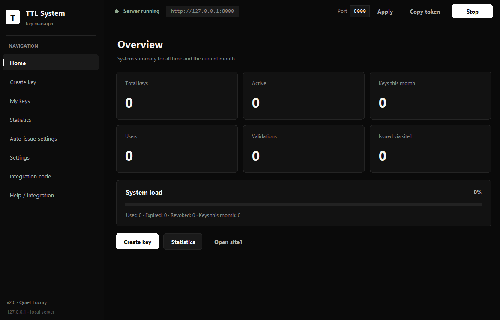
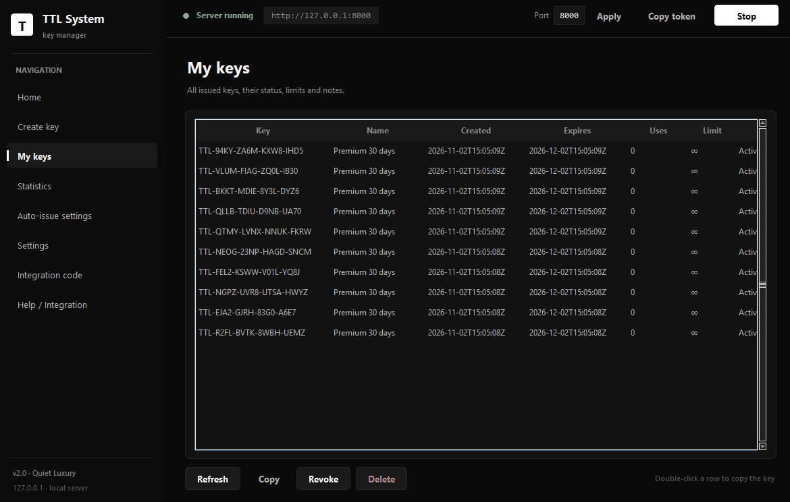
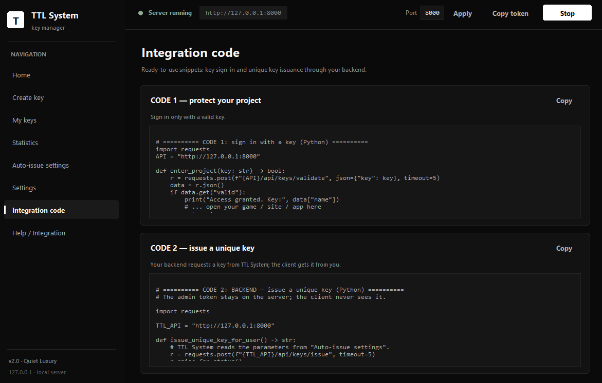

# TTL System

**TTL System** is a Windows program by the **SnimR** group for creating temporary access keys (licenses) for products.

## About

TTL System helps developers and teams control product access:

- Limit trial-period usage (Trial)
- Issue temporary licenses for beta testers
- Flexible access control through a remote server
- Protection against unauthorized key copying

Flagship product of SnimR, focused on easy setup and reliable operation. More information: "We develop innovative software focused on security and user convenience."

## Screenshots

## Downloads

Windows builds are included in this repository:

| File | Type | Description |
| --- | --- | --- |
| `TTLSystemSetup.exe` | Installer (setup) | Installs TTL System into `Program Files` and creates shortcuts |
| `TTLSystemPortable.zip` | Portable archive | No installation required — extract and run `TTL System\TTLSystem.exe` |

Extract/run requires Windows. Antivirus "SmartScreen" may warn because the build is not code-signed; choose "More info → Run anyway" if you trust the source.

## Installation

### Installer

1. Download `TTLSystemSetup.exe`.
2. Run it and follow the wizard.
3. Launch **TTL System** from the Start menu or desktop shortcut.

### Portable

1. Download `TTLSystemPortable.zip`.
2. Extract it to any folder.
3. Run `TTL System\TTLSystem.exe`.

## Account and updates

TTL System is distributed together with a licensing web service:

- Registration and sign-in use email with a 6-digit code.
- The code is valid for 10 minutes; resend cooldown is 60 seconds; up to 5 attempts.
- Every new account gets a **14-day free trial** ("Free" plan).
- After the trial: subscription plans **Plus** and **Pro** (monthly), managed through the web interface.

## System requirements

- **OS:** Windows 10/11 (x64)
- **Disk:** ~25 MB free for the portable build
- No additional runtime required for the packaged build

## Source

- Website/marketing and update-delivery app is a Flask service (email via Gmail SMTP, SQLite storage). Latest builds and changelog are published here.

## Authors

SnimR group — developers of security and usability-focused software.

---

## Русский

**TTL System** — программа для Windows от группы **SnimR** для создания временных ключей доступа (лицензий) к продуктам.

Основные возможности:
- ограничение trial-периода;
- временные лицензии для бета-тестеров;
- гибкое управление доступом через удалённый сервер;
- защита от несанкционированного копирования ключей.

Дистрибутивы: установщик `TTLSystemSetup.exe` и портативный архив `TTLSystemPortable.zip`.

Учётные записи и обновления: вход по email с 6-значным кодом (10 минут, 60 с на повтор, 5 попыток), 14-дневный бесплатный trial, тарифы Plus/Pro помесячно через веб-интерфейс.